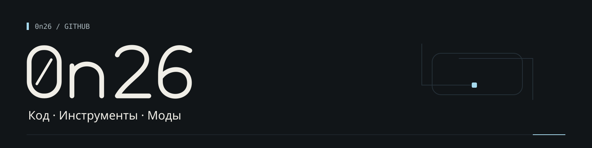
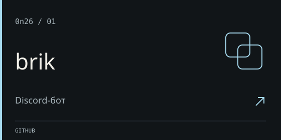
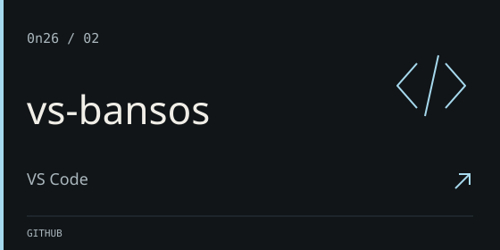
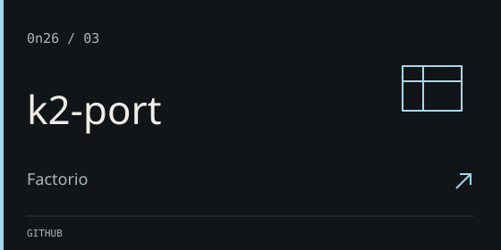

Пишу инструменты для чата и разработки, делаю моды для Factorio.

### Избранное

- **[brik](https://github.com/0n26/brik)** — модульный Discord-бот на TypeScript, discord.js и Bun. Автоматическое подключение модулей и unit-тесты.
- **[vs-bansos](https://github.com/0n26/vs-bansos)** — OpenAI-совместимые провайдеры моделей в VS Code / Copilot Chat через Language Model Chat Provider API.
- **[k2-port](https://github.com/0n26/k2-port)** — порт Advanced Tank из Krastorio 2 с совместимостью с Space Age. Мой вклад: код совместимости, логика технологических бонусов и локализация. Исходный танк и ресурсы принадлежат авторам Krastorio 2 / Krastorio2Assets.

### Стек

TypeScript · Bun · discord.js · VS Code Extension API · Lua

[Все репозитории →](https://github.com/0n26?tab=repositories)
